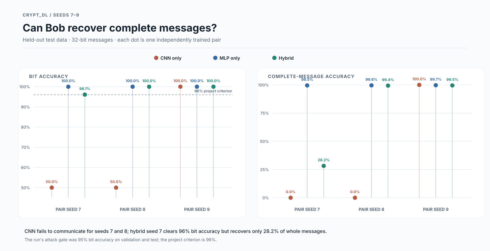
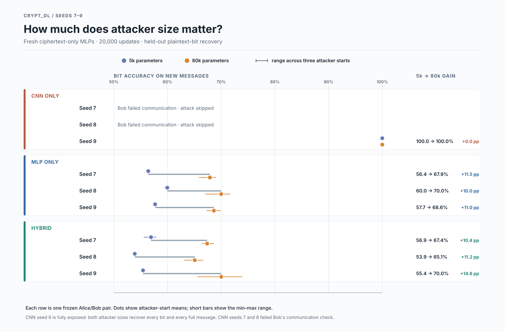

Hello Professor,

Kunj here with my Week 4 update. Following your suggestion, I trained Alice and Bob against a CNN Eve, an MLP Eve, or **both together**. I used the same three Alice/Bob seeds and the same total Eve training budget for each setup.

In my hybrid setup, the CNN Eve and MLP Eve are **separate networks** trained independently from ciphertext without the key. Each gets two updates per Alice/Bob update, and the privacy penalty uses whichever Eve has the lower plaintext-reconstruction error on that batch. **Is this the hybrid model you had in mind, or did you mean one Eve network that combines CNN and MLP components?**

**Main result: Across these three seeds, adding a CNN Eve alongside the MLP Eve during Stage 1 did not provide more protection than training against the MLP Eve alone.** After freezing the trained Alice/Bob pairs, I tested fresh MLP attackers with about 5k and 80k parameters. The 80k attackers recovered similar amounts of plaintext from both setups: **67.49% bit accuracy against hybrid** and **68.85% against MLP-only** (50% is chance). The larger attacker beat the 5k attacker on every successful pair in both setups. Training against two Eves did not stop a fresh MLP from exploiting the learned communication.

The CNN-only runs were unusual. Bob failed to communicate in two of three runs. In the successful run, fresh MLP attackers recovered **100% of complete messages**, while the CNN Eve used during training stayed near chance. I cannot yet tell whether this comes from the CNN Eve's design or its training.

One hybrid run also shows why I now report Bob's full-message accuracy: **96.08% correct bits** meant only **28.22% completely correct messages**.

As a small follow-up, I trained three more Alice/Bob pairs against the MLP Eve, froze Alice, and attacked her ciphertext with 32 XGBoost bit classifiers. Bob decoded **99.96–99.99% of test bits** across the three seeds, but XGBoost recovered only **52.58–53.95%**. A fresh MLP trained on the same 32,768 ciphertext/plaintext pairs reached **52.96–54.37%**; neither attacker recovered a complete 32-bit test message. The attacks did not work especially well with this small dataset and tree budget, although their bit accuracy is above the 50% guessing baseline. The setup and per-seed results are in [RESULTS.md](RESULTS.md).

Next, I plan to test whether a stronger 80k MLP Eve *during training* reduces the leakage, and to inspect the unusual CNN run with saved model checkpoints.

Thank you,  
Kunj

### Figures

**Bob's communication accuracy across the three seeds**

**Fresh MLP attack accuracy after 20,000 training updates**

