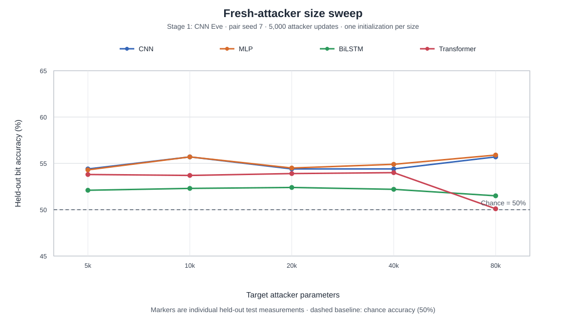
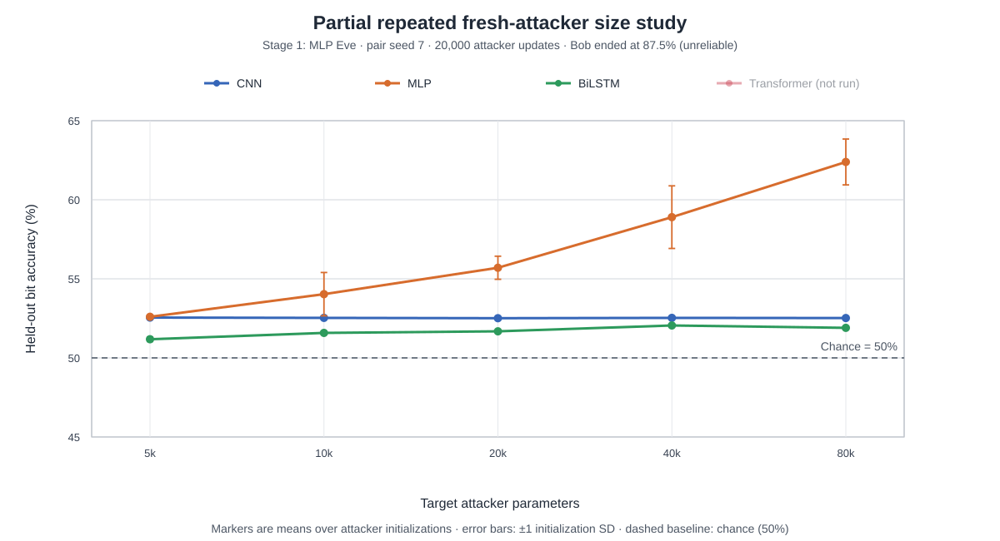
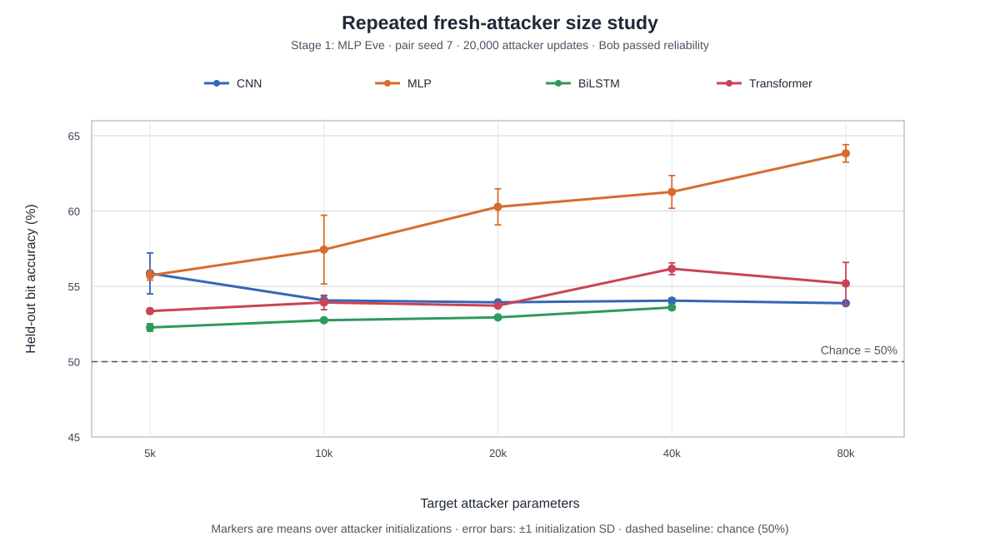
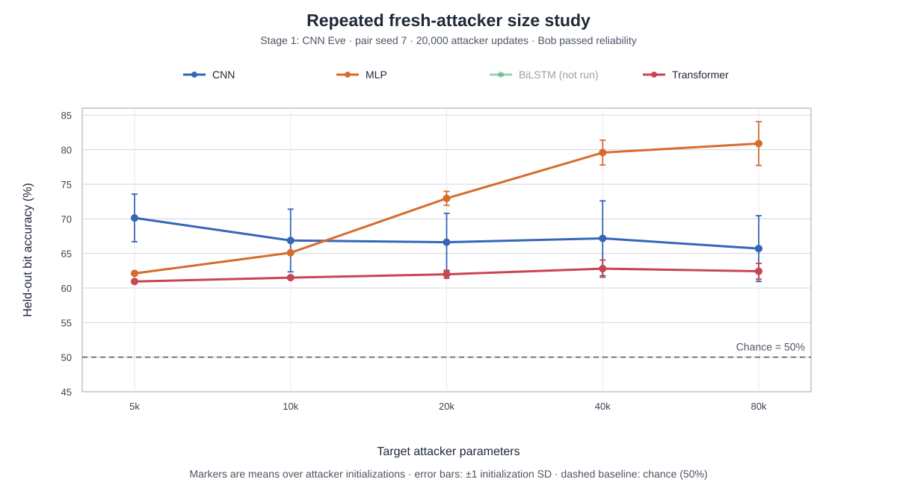

# Results Record: Cross-Architecture Neural Cryptography

## What was measured

Alice encrypts a binary plaintext using a shared binary key, Bob reconstructs it using the ciphertext and key, and Eve/Trudy tries to reconstruct it from ciphertext alone. Results below report held-out attacker bit accuracy; 50% is random guessing. Higher attacker accuracy means more plaintext information was recovered.

These are research experiments, not production cryptography or a replacement for AES/TLS.

## Week 1

**What is it about?** Establishing the baseline behavior of the Alice–Bob–Eve setup: whether fresh attackers with different architectures can recover plaintext after Alice and Bob train against one Eve.

**What results did we want?** Reliable Bob communication plus held-out attack measurements that show which attacker families recover above chance, before isolating capacity as a separate variable.

### 1. Preliminary CNN-trained pilots

#### Setup

- Alice and Bob: standard CNN / mix-and-transform architecture.
- Training attacker: CNN Eve.
- Fresh attackers after Alice/Bob were frozen: CNN, MLP, BiLSTM, and Transformer.
- Message lengths: 16 and 32 bits.
- These attackers were not capacity-matched, so this is a pilot baseline only.

| Fresh attacker | 16-bit accuracy | 32-bit accuracy |
| -------------- | --------------: | --------------: |
| CNN            |           57.9% |           54.8% |
| MLP            |           83.5% |           60.3% |
| BiLSTM         |           88.6% |           72.9% |
| Transformer    |           50.0% |           49.9% |

#### Observation

The BiLSTM recovered substantial information at both message lengths. The Transformer result only means that this particular configuration did not learn an attack in that run; it is not evidence that the learned cipher was secure.

### 2. Five-seed 32-bit CNN-trained sweep

#### Setup

- Alice and Bob: CNN / mix-and-transform architecture.
- Training attacker: CNN Eve.
- Message/key/ciphertext length: 32 bits.
- Alice/Bob adversarial training: 50,000 steps for each seed (7-11).
- Fresh attackers: CNN, MLP, BiLSTM, and Transformer, each trained from scratch for 20,000 steps.
- Evaluation: newly generated held-out plaintext/ciphertext pairs.
- Important limitation: attacker capacities were not yet matched.

| Model                 | Mean bit accuracy | Standard deviation | Mean Hamming error |
| --------------------- | ----------------: | -----------------: | -----------------: |
| Fresh CNN Eve         |            56.36% |              1.93% |         13.96 / 32 |
| Fresh MLP Eve         |            59.93% |              6.06% |         12.82 / 32 |
| Fresh BiLSTM Eve      |            66.52% |             17.16% |         10.71 / 32 |
| Fresh Transformer Eve |            75.34% |             23.57% |          7.89 / 32 |
| Bob                   |           100.00% |              0.00% |                n/a |

#### Observation

Bob communicated reliably, but fresh non-CNN attackers repeatedly decoded above chance. The strongest average attacker was the Transformer, although its large standard deviation shows that success was strongly seed-dependent. This is evidence that training only against one CNN Eve did not create a robust scheme against other learned attackers.

### 3. Capacity-matched 32-bit 4x4 architecture sweep

#### Setup

- Alice and Bob: 19,409-parameter CNNs.
- Message/key/ciphertext length: 32 bits.
- Eve architectures in both roles: CNN, MLP, BiLSTM, Transformer.
- Training Eve: one architecture used while adversarially training Alice/Bob.
- Post-hoc Eve: a fresh attacker architecture trained against each frozen Alice/Bob pair.
- Approximate attacker parameter counts: CNN 23,073; MLP 24,864; BiLSTM 19,441; Transformer 18,209.
- One sweep shown below; 20,000 Alice/Bob training steps per row and 8,000 fresh-attacker steps per cell.
- The current notebook supports seed 42 or 7, but multi-seed repetition has not yet been completed for this matrix.

| Training Eve \\ fresh attacker |    CNN |    MLP | BiLSTM | Transformer |
| ------------------------------ | -----: | -----: | -----: | ----------: |
| CNN                            | 54.23% | 63.35% | 50.93% |      53.37% |
| MLP                            | 52.82% | 57.65% | 51.33% |      52.30% |
| BiLSTM                         | 59.00% | 60.75% | 57.00% |      58.46% |
| Transformer                    | 54.49% | 56.30% | 51.29% |      53.47% |

#### Observation

Most cells are close to chance, but the MLP reaches 63.35% against the pair trained with a CNN attacker. This suggests that attacker architecture can matter even when the models are in a similar parameter range. Because this is currently a single-seed result, it needs repeated runs before making a strong architecture-level claim.

### 4. Pretrained ResNet-18 Alice/Bob, 64-bit experiments

#### Setup

- Alice and Bob: genuine ImageNet-pretrained ResNet-18 models, not ResNets trained from scratch.
- Input: 64-bit message plus 64-bit key, reshaped into an 8x16 three-channel image and resized to 224x224.
- Fine-tuning: pretrained stem through `layer3` frozen; `layer4` and a new 64-value output head trainable.
- Training attacker: CNN Eve.
- Fresh attackers: CNN, MLP, BiLSTM, Transformer, and Extreme Learning Machine (ELM).
- Evaluation: held-out 64-bit plaintext/ciphertext pairs.
- Key limitation: this changes both the architecture size and the input representation, so it cannot isolate the effect of size alone.

| Fresh attacker | Earlier run | Longer Alice/Bob training run |
| -------------- | ----------: | ----------------------------: |
| CNN            |       71.8% |                         64.7% |
| MLP            |       70.4% |                         64.2% |
| BiLSTM         |       52.8% |                         50.0% |
| Transformer    |       65.9% |                         63.2% |
| ELM            |       63.6% |                         64.2% |

#### Observation

Several fresh attackers remained clearly above chance in both runs. Longer Alice/Bob training reduced the CNN, MLP, and Transformer attack scores in these recorded runs, but did not remove the vulnerability. This is a preliminary comparison only: it does not show that larger attackers are consistently stronger, or that longer training alone caused the change.

## Week 2

**What is it about?** The effect of a fresh attacker's architecture size on plaintext recovery from one frozen Alice–Bob pair. The Stage-1 Eve is held fixed within each sweep; its architecture is not the variable being tested. The later repeated study also tests whether the apparent size effect changes with attacker initialization and training time.

**What results did we want?** For each fresh attacker family, determine whether increasing its parameter count from roughly 5k to 80k consistently increases held-out plaintext recovery, whether the trend survives repeated initializations, and whether it becomes clearer after longer attacker training.

### 5. Fresh attacker size sweep against one frozen 32-bit Alice/Bob pair

#### Setup

- Seed: 7. One Alice/Bob pair was trained against a CNN Eve, then frozen for all attacks.
- Alice, Bob, and training Eve: 40,609 CNN parameters each; Bob's held-out bit accuracy is shown as 100.0% in the figure.
- Fresh attacker families: CNN, MLP, BiLSTM, Transformer. Each family was tested at target sizes of 5k, 10k, 20k, 40k, and 80k parameters.
- Each fresh attacker was trained for 5,000 steps and evaluated on the same 16,384 held-out messages. Chance bit accuracy is 50%.
- Accuracies below are transcribed from the figure and rounded to one decimal place; parameter counts are the actual model sizes printed on the figure.

| Target size |            CNN |            MLP |         BiLSTM |    Transformer |
| ----------- | -------------: | -------------: | -------------: | -------------: |
| 5k          |  54.4% (5,073) |  54.3% (5,027) |  52.1% (4,831) |  53.8% (5,009) |
| 10k         | 55.7% (10,253) |  55.7% (9,968) | 52.3% (10,133) | 53.7% (10,585) |
| 20k         | 54.4% (20,137) | 54.5% (19,968) | 52.4% (19,681) | 53.9% (18,209) |
| 40k         | 54.4% (39,757) | 54.9% (40,152) | 52.2% (39,883) | 54.0% (39,601) |
| 80k         | 55.7% (79,907) | 55.9% (80,168) | 51.5% (79,381) | 50.1% (77,861) |

#### Observation

Fresh CNN and MLP attackers recover about 54–56% of plaintext bits at every tested size, so the pair leaks information even to approximately 5k-parameter attackers. BiLSTM recovers less (51.5–52.4%). None of the four families shows a consistent increase in accuracy as parameter count rises. The 80k Transformer drops to 50.1% despite smaller Transformers reaching about 54%; this is one attack run, so it could reflect optimization or initialization rather than a benefit of greater size. The strongest recorded attacker is the 80k MLP at 55.9%, only 1.6 percentage points above the 5k MLP. These results describe one trained Alice/Bob pair and one attacker initialization per size; repeated attacker starts and more training steps are needed to establish a reliable size trend.

### 6. Fresh attacker size sweep after training Alice/Bob against an MLP Eve

#### Setup

- Notebook: [`scripts/mlp_attacker_size_same_pair.ipynb`](scripts/mlp_attacker_size_same_pair.ipynb).
- Seed: 7. Alice and Bob were trained against a ciphertext-only `MLP(32 → 133 → 218 → 32)` Eve, then frozen for all attacks.
- Alice, Bob, and the training MLP Eve each have 40,609 parameters. Bob's held-out bit accuracy was 100.0%.
- Fresh CNN, MLP, BiLSTM, and Transformer attackers were tested at 5k, 10k, 20k, 40k, and 80k target parameters; each attack used 5,000 steps and the same 16,384 held-out messages.
- Accuracies are transcribed from the supplied chart and rounded to one decimal place. Parentheses show the actual parameter count.

| Target size |            CNN |            MLP |         BiLSTM |    Transformer |
| ----------- | -------------: | -------------: | -------------: | -------------: |
| 5k          |  52.9% (5,073) |  52.8% (5,027) |  50.7% (4,831) |  51.9% (5,009) |
| 10k         | 52.9% (10,253) |  52.8% (9,968) | 51.0% (10,133) | 52.2% (10,585) |
| 20k         | 52.8% (20,137) | 52.8% (19,968) | 51.3% (19,681) | 52.4% (18,209) |
| 40k         | 52.8% (39,757) | 52.8% (40,152) | 51.4% (39,883) | 52.4% (39,601) |
| 80k         | 52.9% (79,907) | 52.8% (80,168) | 52.0% (79,381) | 50.0% (77,861) |

#### Observation

All recorded fresh attackers are close to chance (50%). CNN and MLP recovery is essentially flat at about 52.8–52.9% across the tested capacities. BiLSTM rises gradually from 50.7% to 52.0%, while the Transformer reaches 52.4% at 20k–40k parameters before falling to chance at 80k. This single run does not show a consistent gain from attacker size; differences at this scale may reflect optimization and initialization. Repeating each size across seeds and attacker initializations is required before making a reliable claim about the effect of architecture size.

### 7. Partial repeated attacker-size study on A100

#### Setup and completion status

- Notebook: [`scripts/attacker_size_repeated_a100.ipynb`](scripts/attacker_size_repeated_a100.ipynb).
- Pair seed: 7. Alice and Bob were trained for 5,000 steps against a 40,609-parameter MLP Eve, then frozen.
- Fresh attacker seeds: 101, 102, and 103. Target sizes: 5k, 10k, 20k, 40k, and 80k parameters.
- Each attacker used batches of 16,384 and was evaluated on the same 65,536 held-out messages at 5,000 and 20,000 steps.
- The interrupted run produced all CNN and MLP results. It produced all BiLSTM 5k-step measurements, but only two of the three 80k BiLSTMs reached 20k steps. No Transformer attack started.
- Consequently, 44 of the planned 60 attackers completed 20,000 steps; a 45th attacker reached the 5,000-step checkpoint.
- Important validity warning: Bob finished at only **87.50% bit accuracy** (4.00 wrong bits per 32-bit message on average), below the notebook's 99% reliability criterion. This was not a successfully synchronized Alice-Bob pair.

Values below are mean held-out bit accuracy +/- sample standard deviation across attacker seeds. Each cell has `n=3`, except the marked 80k BiLSTM result at 20k steps, which has `n=2`.

#### After 5,000 attack steps

| Target size |             CNN |             MLP |          BiLSTM | Transformer |
| ----------- | --------------: | --------------: | --------------: | ----------: |
| 5k          | 52.24 +/- 0.01% | 52.22 +/- 0.19% | 50.41 +/- 0.05% | not reached |
| 10k         | 52.44 +/- 0.17% | 52.54 +/- 0.01% | 50.66 +/- 0.20% | not reached |
| 20k         | 52.43 +/- 0.18% | 52.56 +/- 0.01% | 50.60 +/- 0.13% | not reached |
| 40k         | 52.43 +/- 0.19% | 52.65 +/- 0.15% | 50.69 +/- 0.05% | not reached |
| 80k         | 52.32 +/- 0.20% | 52.71 +/- 0.26% | 50.91 +/- 0.07% | not reached |

#### After 20,000 attack steps

| Target size |             CNN |             MLP |                BiLSTM | Transformer |
| ----------- | --------------: | --------------: | --------------------: | ----------: |
| 5k          | 52.55 +/- 0.01% | 52.60 +/- 0.05% |       51.18 +/- 0.14% | not reached |
| 10k         | 52.53 +/- 0.01% | 54.03 +/- 1.37% |       51.58 +/- 0.08% | not reached |
| 20k         | 52.51 +/- 0.02% | 55.70 +/- 0.73% |       51.68 +/- 0.04% | not reached |
| 40k         | 52.53 +/- 0.01% | 58.90 +/- 1.98% |       52.05 +/- 0.03% | not reached |
| 80k         | 52.52 +/- 0.03% | 62.39 +/- 1.45% | 51.90 +/- 0.08% (n=2) | not reached |

#### Observation

The main result is a clear interaction between attacker size and training time for the MLP. At 5,000 steps, its mean accuracy changes only from 52.22% at 5k parameters to 52.71% at 80k parameters, which looks nearly flat. At 20,000 steps, it rises steadily from 52.60% to 62.39%, a 9.80 percentage-point difference. The effect is not produced by one lucky restart: every 80k MLP reached 60.78-63.61%, whereas every 5k MLP remained at 52.56-52.66%. This is strong evidence that the earlier 5,000-step sweeps could hide a capacity effect by stopping larger MLP attackers too early.

The effect is architecture-specific. CNN accuracy is essentially identical across all five sizes after 20,000 steps (52.51-52.55%), so extra CNN parameters did not help in this range. BiLSTM improves more slowly, from 51.18% at 5k parameters to about 52.0% at 40k-80k, but the increase is small and the 80k result is incomplete. Since no Transformer runs were reached, the experiment cannot say anything about Transformer size.

The result is useful for studying attacker optimization and capacity **conditional on this frozen pair**, but it is not a valid successful-cryptography result: Bob's training became unstable after initially reaching very low reconstruction error and finished with only 87.5% bit accuracy. It also comes from one Alice-Bob pair. Therefore, the strongest defensible conclusion is: **attacker size can matter substantially, but only after sufficient training and only for some architectures; this interrupted run does not establish that the pattern generalizes to reliably synchronized pairs.**

## Week 3

**What is it about?** Completing the missing Transformer arm of the repeated attacker-size study, this time against a successfully synchronized frozen Alice-Bob pair.

**What results did we want?** Determine whether attacker capacity improves held-out plaintext-bit recovery after 20,000 training updates, while separating the effect of capacity from attacker initialization.

### 8. Repeated fresh-attacker size study

#### Setup

- Pair seed: 7. Bob passed the reliability check (`Bob reliability: {7: True}`).
- Alice: CNN / `CryptCNN`, 40,609 parameters.
- Bob: CNN / `CryptCNN`, 40,609 parameters.
- Stage-1 Eve: ciphertext-only `MLP(32 → 133 → 218 → 32)`, 40,609 parameters.
- Fresh attacker families: CNN, MLP, BiLSTM, and Transformer, each targeted at 5k, 10k, 20k, 40k, and 80k parameters. The actual parameter count for each family/size is shown in the tables.
- Attacker initializations: seeds 101, 102, and 103 for every family and size.
- Reported training budget: 20,000 updates. The Transformer, CNN, and MLP arms completed all 15 attackers each; BiLSTM completed all sizes through 40k, while its 80k runs are not yet complete.
- Overall status at the reported checkpoint: results are available for 57 of 60 expected family/size/initialization conditions. The three missing conditions are the 80k BiLSTM attacker initializations.
- Metrics below are mean held-out bit accuracy over attacker initializations. The value in parentheses is the between-initialization standard deviation in percentage points; `n=1` means no standard deviation is available. Chance bit accuracy is 50%; full-message accuracy is the fraction of complete 32-bit messages recovered exactly.

#### Results after 20,000 attacker updates

| Target size |                               CNN |                               MLP |                            BiLSTM |                       Transformer |
| ----------- | --------------------------------: | --------------------------------: | --------------------------------: | --------------------------------: |
| 5k          |  55.86% (1.36 pp) 5,073 params |  55.73% (0.31 pp) 5,027 params |  52.27% (0.25 pp) 4,831 params |  53.36% (0.16 pp) 5,009 params |
| 10k         | 54.07% (0.29 pp) 10,253 params |  57.44% (2.28 pp) 9,968 params | 52.75% (0.11 pp) 10,133 params | 53.93% (0.48 pp) 10,585 params |
| 20k         | 53.94% (0.06 pp) 20,137 params | 60.28% (1.20 pp) 19,968 params | 52.94% (0.11 pp) 19,681 params | 53.72% (0.08 pp) 18,209 params |
| 40k         | 54.05% (0.16 pp) 39,757 params | 61.27% (1.09 pp) 40,152 params | 53.60% (0.16 pp) 39,883 params | 56.17% (0.39 pp) 39,601 params |
| 80k         | 53.88% (0.02 pp) 79,907 params | 63.83% (0.58 pp) 80,168 params | not yet complete 79,381 params | 55.19% (1.40 pp) 77,861 params |

Full-message accuracy was 0.0% in every completed condition. The validation-selected initialization also had 0.0% full-message accuracy in every completed condition; selection used validation L1 rather than test accuracy.

#### Observation

The new CNN result is essentially flat once the anomalously variable 5k point is set aside: 10k through 80k CNNs are all about 53.9-54.1%. Its fitted capacity slope is -0.40 pp per doubling, but this is driven by the 5k mean of 55.86% (SD 1.36 pp), rather than evidence that smaller CNNs are reliably better. More CNN parameters do not help in this range.

MLP is the clear exception. It rises from 55.73% at 5k parameters to 63.83% at 80k (8.10 pp; fitted slope 2.00 pp per doubling). The larger MLPs have some initialization variation, especially 10k (2.28 pp), but the overall capacity pattern is strong.

BiLSTM shows a modest, orderly improvement through 40k, from 52.27% to 53.60%. The 80k BiLSTM is incomplete, so no endpoint difference or fitted size effect should be reported yet. Transformers learn a **small but reproducible above-chance bit-level attack**, not a strong plaintext decoder. Their fitted slope is 0.61 pp per doubling and 80k is 1.83 pp above 5k. The curve remains non-monotonic: 40k is best at 56.17%, but 80k drops to 55.19% with the largest initialization variation (1.40 pp).

The zero exact-message recovery rate is consistent with these being bit-level leaks rather than end-to-end plaintext recovery. Taken together, these results show a strong MLP capacity effect, little or no CNN capacity effect, a modest incomplete BiLSTM trend, and a weaker non-monotonic Transformer trend. They are encouraging because Bob passed the reliability check, but they still come from one frozen Alice-Bob pair and need replication across independently trained, reliable pairs before they support a general architecture-level claim.

### 9. Repeated fresh-attacker size study after CNN-Eve Stage 1 training

#### Setup

- Pair seed: 7. Alice and Bob were synchronized while training against a ciphertext-only CNN Eve (`CNNEve(width=54)`, 39,757 parameters), then frozen. Bob passed the reliability check (`Bob reliability: {7: True}`).
- Alice: CNN / `CryptCNN`, 40,609 parameters.
- Bob: CNN / `CryptCNN`, 40,609 parameters.
- Stage-1 Eve: ciphertext-only `CNNEve(width=54)`, 39,757 parameters.
- Fresh attacker families: CNN, MLP, and Transformer. Each was tested at target sizes of 5k, 10k, 20k, 40k, and 80k parameters.
- Attacker initializations: seeds 101, 102, and 103. Each attacker was evaluated after 5,000 and 20,000 updates.
- Completion: all 45 attackers and all 90 expected test records completed. Metrics below are the mean held-out bit accuracy at 20,000 updates; parentheses contain the between-initialization standard deviation in percentage points.

| Target size |                               CNN |                               MLP |                       Transformer |
| ----------- | --------------------------------: | --------------------------------: | --------------------------------: |
| 5k          |  70.13% (3.44 pp) 5,073 params |  62.11% (0.19 pp) 5,027 params |  60.94% (0.14 pp) 5,009 params |
| 10k         | 66.87% (4.53 pp) 10,253 params |  65.10% (0.19 pp) 9,968 params | 61.50% (0.12 pp) 10,585 params |
| 20k         | 66.62% (4.17 pp) 20,137 params | 72.96% (1.02 pp) 19,968 params | 61.98% (0.58 pp) 18,209 params |
| 40k         | 67.18% (5.42 pp) 39,757 params | 79.58% (1.79 pp) 40,152 params | 62.80% (1.24 pp) 39,601 params |
| 80k         | 65.70% (4.75 pp) 79,907 params | 80.89% (3.16 pp) 80,168 params | 62.42% (1.13 pp) 77,861 params |

At 20,000 updates, full-message accuracy remained 0.0% for CNN and Transformer attackers. MLP achieved 0.13% at 40k and 0.32% at 80k, so it recovered some complete 32-bit messages. Validation-selected initializations were chosen by validation L1, not test accuracy.

#### Observation

This CNN-Eve-trained pair is **substantially more vulnerable** to fresh attacks than the MLP-Eve-trained Week 3 pair. All attacker families exceed 60% bit accuracy after 20,000 updates. In particular, MLP rises sharply from 62.11% at 5k parameters to 80.89% at 80k: an 18.78 pp endpoint difference and a fitted gain of 5.21 pp per parameter doubling. The 40k and 80k MLPs also achieve nonzero exact-message recovery, making this much more than a weak bit-level leak.

Fresh CNNs are also strong (65.70-70.13%) but do not improve monotonically with size. Their 5k-to-80k difference is -4.44 pp and the initialization standard deviations are large (3.44-5.42 pp), so this does not establish a negative CNN capacity effect; it shows that any CNN in this tested range can exploit the pair after sufficient training. Transformers are weaker than CNNs and MLPs but still consistently leak information (60.94-62.80%). Their capacity effect is modest: 0.43 pp per doubling and a 1.48 pp 5k-to-80k increase.

The important comparison is qualitative, not causal: with one frozen pair for each Stage-1 Eve architecture, these data show that training against this CNN Eve did not yield a robust learned cipher and produced a pair that fresh MLPs break strongly. Repeating the matched comparison across multiple pair seeds is required before concluding that CNN-Eve Stage 1 training is intrinsically less robust than MLP-Eve Stage 1 training.

## Current interpretation

Across the repeated 20,000-update studies on reliable pairs, attacker architecture, capacity, training time, and the Stage-1 Eve all interact. Against the MLP-Eve-trained pair, MLP has a strong size trend, Transformer has a weaker non-monotonic trend, CNN is flat, and the incomplete BiLSTM results rise modestly through 40k. Against the CNN-Eve-trained pair, MLP attacks scale sharply to 80.89% bit accuracy and recover some complete messages, while CNN and Transformer attacks are also well above chance at every tested size. Parameter count alone therefore does not predict attack strength or learned-cipher robustness.

## Reference

Abadi and Andersen's evaluation also resets and retrains Eve after Alice and Bob are trained; they treat a fresh Eve with a substantial advantage as evidence that a learned scheme is non-robust. Their paper reports experiments at 16, 32, and 64 bits, but does not establish that a larger attacker is always stronger: [Learning to Protect Communications with Adversarial Neural Cryptography (2016)](https://arxiv.org/abs/1610.06918).
